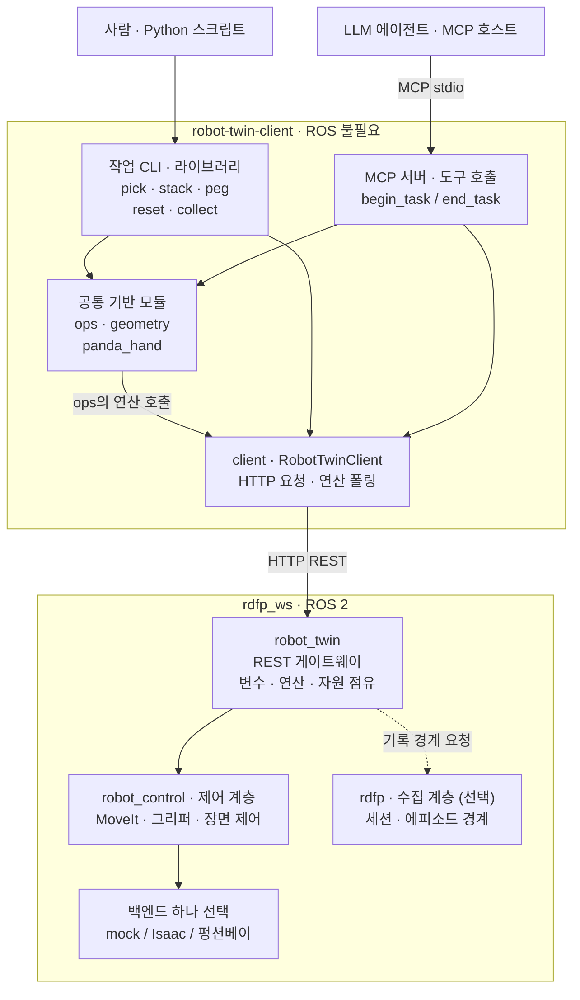
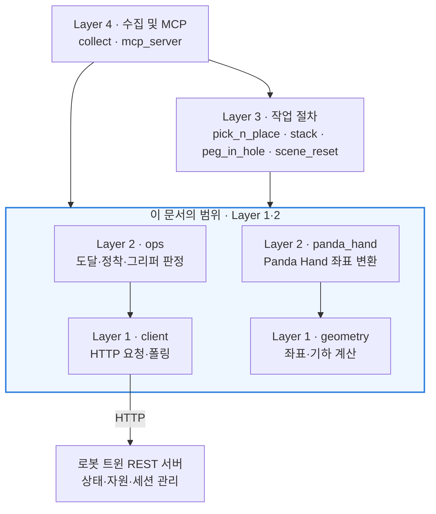
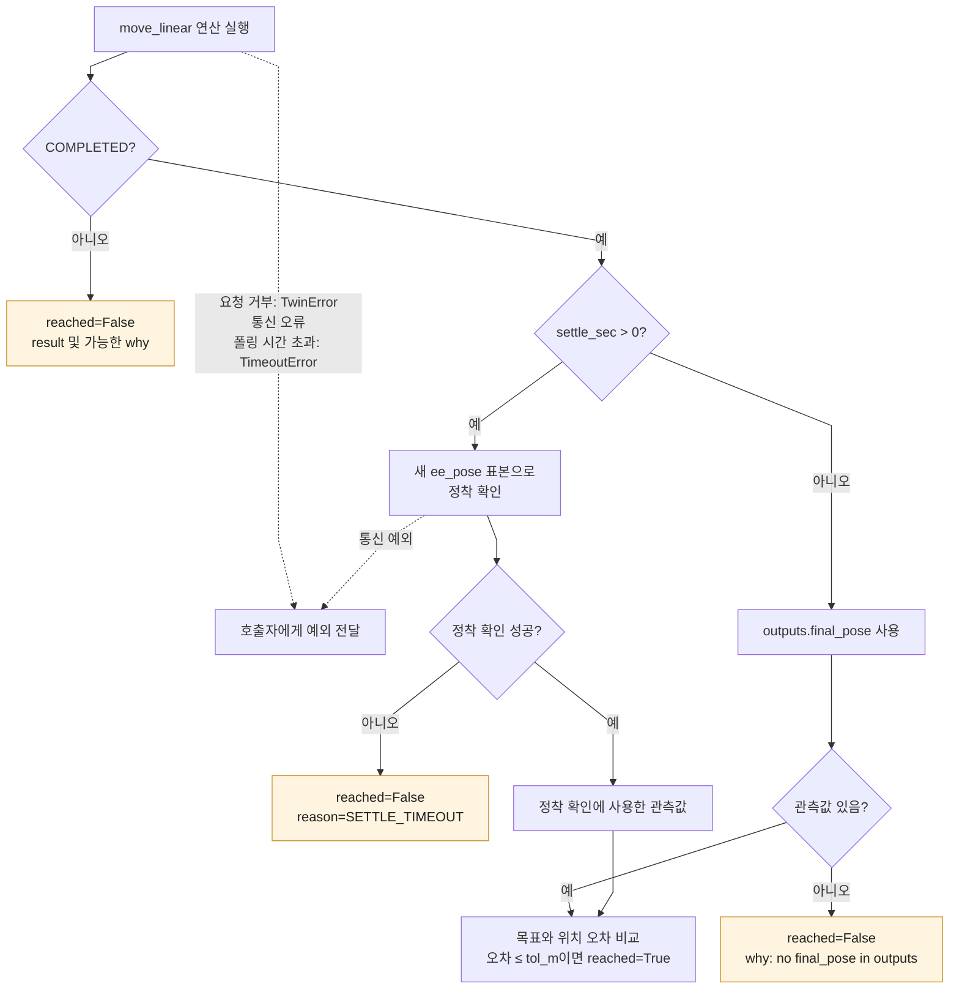
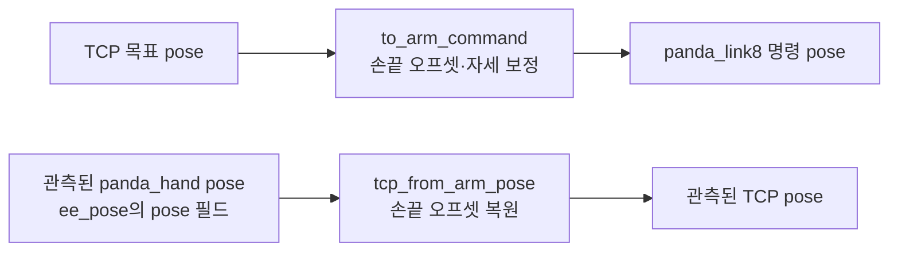

# RobotTwinClient 가이드

이 문서는 `RobotTwinClient`와 검증·좌표 헬퍼를 포함한 **Layer 1·2 기반 라이브러리**의 사용 가이드다. 트윈에 접속하고, 상태를 읽고, 목표 좌표를 만들고, 연산 결과를 판정하는 방법을 설명한다.

Layer 3·4의 작업 절차·데이터 수집·MCP 운영은 1.1절의 상위 응용 자료를 참고한다.

## 1. 기반 라이브러리의 역할과 범위

`RobotTwinClient`는 `rdfp_ws`의 로봇 트윈 REST API를 HTTP로 호출하는 파이썬 객체다. 로봇 상태·자원 락·실행 세션은 서버가 관리하며, 클라이언트 객체는 접속 주소와 HTTP 시간 제한을 보관한다. 같은 주소로 객체를 두 개 만들어도 같은 트윈에 접속한다.

기반 라이브러리는 네 모듈로 구성된다.

| Layer | 모듈 | 담당하는 일 | 패키지 내부 의존 |
|---|---|---|---|
| 1 | `client` | 상태 조회, 연산 요청·폴링, 예외 전달 | 없음 |
| 1 | `geometry` | 물체 좌표 해석, 목표 pose 생성, 쿼터니언 계산 | 없음 |
| 2 | `ops` | 연산 종료 후 도달·정착·그리퍼 결과 판정 | `client` |
| 2 | `panda_hand` | Panda Hand의 손끝 목표와 팔 명령 좌표 변환 | `geometry` |

이 네 모듈의 소스는 상위 작업 모듈을 import하지 않는다. 다만 패키지의 `__init__.py`는 편의상 기반·응용 이름을 함께 가져와 내보낸다. 따라서 계층 구분은 모듈의 책임과 의존 관계를 뜻하며, 별도 배포 패키지나 완전히 분리된 로딩 단위를 뜻하지는 않는다. 이 문서의 예제에서는 이름의 소속을 알 수 있도록 모듈에서 직접 import한다.

### 1.1 전체 구조에서의 위치

사람은 작업 CLI·Python 라이브러리를, 에이전트는 MCP 도구를 통해 같은 트윈을 호출한다. 클라이언트와 ROS 스택의 배치는 다음과 같다. 화살표는 주요 호출 경로이며, 수집 계층은 기록 경계를 사용하는 경우에 추가한다.



`collect`와 MCP의 `begin_task`·`end_task`는 수집 경계를 요청한다. 실제 영상·rosbag 기록 프로세스는 별도로 준비한다. 작업 실행은 [작업 및 데이터 수집 가이드](RobotTwinClient_작업_및_데이터_수집_가이드.md), 에이전트 연결은 [MCP 가이드](로봇_트윈_MCP_서버_설계_및_운영_가이드.md)에서 설명한다.

아래 그림의 실선 화살표는 의존·호출 방향이다. `geometry`와 `panda_hand`는 좌표만 계산하며 로봇에 명령을 보내지 않는다.



| 범위 | 다루는 내용 |
|---|---|
| 이 문서 | 설치·접속, 상태와 연산 API, 검증 헬퍼, 좌표 규약, 기본 호출 예제, 예외 처리 |
| 상위 응용 | 작업 CLI·작업 절차·수집은 [작업 및 데이터 수집 가이드](RobotTwinClient_작업_및_데이터_수집_가이드.md), MCP 등록·도구 사용은 [MCP 서버 설계 및 운영 가이드](로봇_트윈_MCP_서버_설계_및_운영_가이드.md) 참고 |
| 서버 문서 | 로봇 트윈 기동, ROS 제어 스택, 백엔드 설정, REST 자원·세션 모델 |

### 1.2 먼저 알아둘 개념

| 용어 | 의미 |
|---|---|
| 상태 변수 | `ee_pose`처럼 트윈이 읽어 주는 관측값. 값과 함께 품질·시각 정보가 온다 |
| 연산 | `move_linear`처럼 트윈이 실행하는 동작. 즉시 결과를 주거나 실행 세션을 반환한다 |
| `COMPLETED` | 서버가 연산을 정상 종료했다는 상태. 모든 동작에서 목표 도달을 보장하지는 않는다 |
| 정착 | 새 관측값의 위치가 일정 시간 동안 허용 범위 안에 머무는 상태 |
| TCP | 손끝의 기준점(tool center point). 목표가 어느 점의 위치인지 구분할 때 사용한다 |
| pose | `position`과 `orientation`으로 표현한 위치·자세 |
| named target | SRDF에 미리 정의된 관절 자세의 이름. 예: `ready` |

### 1.3 프로젝트 파일 찾기

| 경로 | 역할 |
|---|---|
| [pyproject.toml](../pyproject.toml) | 패키지·의존성·콘솔 명령 6개·빌드 설정 |
| [src/robot_twin_client/](../src/robot_twin_client/) | 기반 라이브러리·작업·수집·MCP 구현 |
| [.env](../.env) | pytest 실행 시 ROS 플러그인 자동 로드를 막는 환경 변수 |
| [.vscode/launch.json](../.vscode/launch.json) | VS Code의 작업 디버그 구성. 실행 대상·인자를 여기서 확인 |
| [sbin/](../sbin/) | MCP 등록·점검, CLI 설치, 반복 쌓기 보조 스크립트 |
| [tests/](../tests/) | 기반·작업 단위 테스트와 MCP 프로토콜 테스트 |
| [docs/](./) | 기반·작업 및 수집·MCP 가이드와 보존 자료 |

## 2. 설치와 첫 접속

### 2.1 설치

Python 3.10 이상과 `uv`를 준비하고 프로젝트 루트에서 사용 범위에 맞는 동기화 명령 하나를 실행한다.

```bash
cd ~/development/mdtpy/robot-twin-client

# 기반 라이브러리·작업 CLI만 사용하는 환경
uv sync

# 같은 체크아웃의 .venv로 MCP 서버도 실행하는 환경
uv sync --extra mcp
```

기반 라이브러리의 실행 의존성은 파이썬 표준 라이브러리뿐이다. 클라이언트 터미널에는 ROS 설치나 `install/setup.bash` 소싱이 필요 없다. `uv sync`는 프로젝트 환경을 구성하며 기본 개발 의존성인 pytest도 설치한다. 이 문서의 예제에는 `mcp` extra가 필요 없다.

[pyproject.toml](../pyproject.toml)의 빌드 백엔드는 `hatchling.build`이며 빌드 의존성은 `hatchling`, 개발 의존성은 `pytest>=8.0`이다. 빌드 도구와 테스트 도구는 기반 라이브러리의 실행 의존성과 구분한다.

파이썬 import 이름은 `robot_twin_client`다. `rdfp_ws`에는 서버 본체인 ROS 패키지 `robot_twin`이 이미 있다. 예전처럼 같은 이름을 쓰면 ROS를 소싱한 셸의 `PYTHONPATH`가 editable 설치보다 먼저 검색되어 다른 패키지가 로드될 수 있으므로 이름을 분리했다. 배포·프로젝트 이름은 `robot-twin-client`이며, 콘솔 명령과 MCP 등록 이름은 충돌하지 않아 `robot-twin-*`·`robot-twin`을 유지한다.

**MCP 서버를 함께 사용한다면 이후 동기화에도 `uv sync --extra mcp`를 사용한다.** 기본 `uv sync`는 선택하지 않은 의존성을 제거하므로, 이전에 설치한 `mcp`·`jsonschema`가 삭제될 수 있다. 현재 `rdfp_ws`의 `.mcp*.json`은 이 체크아웃의 `.venv/bin/robot-twin-mcp`를 직접 실행하므로 의존성이 제거되면 서버 기동이 실패한다. `--inexact`는 기존 패키지를 보존하지만 누락된 MCP 의존성을 설치해 주지는 않는다.

### 2.2 접속 대상 확인

로봇 스택과 트윈 서버가 먼저 실행되어 있어야 한다. 서버 기동 절차는 [로봇 트윈 사용자 가이드](../../../ros/rdfp_ws/docs/twin/로봇_트윈_사용자_가이드.md)를 따른다.

현재 제공 설정은 펑션베이가 `127.0.0.1:8801 / rdfp01`, Isaac이 `127.0.0.1:8801 / panda01`, mock이 `127.0.0.1:8801 / mock01`을 사용한다. `twin_id`의 기본값은 `rdfp01`이다. 아래 주소는 같은 컴퓨터에서 서버를 실행하는 경우이며, 원격 접속 시 `base_url`을 변경한다.

| 백엔드 | `meta()['backend']` | 좌표 처리의 특징 |
|---|---|---|
| mock | `panda_mock` | Panda Hand 목표를 클라이언트에서 팔 명령으로 변환 |
| Isaac Sim | `panda_isaac` | Panda Hand 목표를 클라이언트에서 팔 명령으로 변환 |
| 펑션베이 | `panda_functionbay` | 제공 트윈이 프레임 변환을 담당하며 기본 기준점은 `grasp_center` |

제공 설정은 환경을 하나씩 바꿔 실행하는 구성이다. 접속 주소만으로 백엔드를 구별할 수 없으므로 `meta()`로 확인한다. 사용자 설정의 주소·프레임은 실제 서버 설정을 따른다.

다음 예제를 `check_twin.py`로 저장한 뒤 `uv run python check_twin.py`로 실행할 수 있다. 상태 조회만 수행한다.

```python
from robot_twin_client.client import RobotTwinClient

twin = RobotTwinClient(
    base_url='http://127.0.0.1:8801',
    twin_id='rdfp01',
    http_timeout_sec=30.0,
    agent='check_twin',
)

print(twin.meta())
print(twin.health())
print(twin.read_raw('ee_pose'))
```

첫 접속에서는 `read_raw()`로 값과 품질·사유를 함께 확인한다. 기동 직후 값이 아직 없으면 `NO_DATA`를 출력하며, 이 품질 상태 자체는 예외로 바뀌지 않는다. 연결 실패 등의 통신 예외는 그대로 전달된다. `read()`의 품질 검사 방식은 3.1절에서 설명한다.

`agent`는 선택 인자다. 요청마다 `User-Agent: robot-twin-client/<버전> (<agent>)` 헤더가 실리고, 트윈은 이 값을 감사 로그에 남긴다. 이름을 주면 로그에서 어느 스크립트·서버가 보낸 요청인지 가를 수 있다. 생략하면 `robot-twin-client/<버전>`만 보낸다. 제공 CLI는 자기 명령 이름(`robot-twin-peg` 등)을, MCP 서버는 `mcp`를 쓴다.

객체 생성 자체는 통신하지 않는다. 서버 주소나 연결 문제가 있으면 첫 API 호출에서 드러난다. API 기본 주소는 `{base_url}/api/v1/robot_twins/{twin_id}`다.

`base_url`은 서버 루트(`http(s)://호스트[:포트]`)만 받는다. https와 IPv6(`http://[::1]:8801`)는 그대로 쓸 수 있다. 스킴이 빠진 주소(`127.0.0.1:8801`)나 경로가 붙은 주소(`https://gw.example/twin`)는 생성 시 `ValueError`가 난다. 경로를 거부하는 이유는 트윈이 비동기 연산의 `session_endpoint`를 접두사 없는 절대 경로(`/api/v1/...`)로 돌려주기 때문이다. 접두사를 붙인 리버스 프록시 뒤에서는 동기 연산만 되고 폴링이 404로 실패한다.

특정 백엔드가 필요한 코드는 연산 전에 별도 함수 `require_backend()`로 확인한다.

```python
from robot_twin_client.client import require_backend

require_backend(twin, 'panda_mock', 'panda_isaac', purpose='Panda Hand 좌표 변환')
```

반환값은 확인된 백엔드 이름이며, 기대 목록과 다르면 `WrongBackend`가 발생한다. 이 확인은 접속 환경을 검사하며, 사용자 설정의 그리퍼·프레임까지 검증하지는 않는다.

## 3. 상태 조회와 연산 호출 — client

### 3.1 상태와 카탈로그 읽기

| 메서드 | 반환값·동작 |
|---|---|
| `meta()` | 트윈 ID·백엔드 등 메타데이터 |
| `health()` | 서버가 보고하는 준비 상태 |
| `read(name, *, require_ok=True)` | 변수의 `value`. 기본적으로 `quality != 'OK'`이면 `RuntimeError` |
| `read_raw(name)` | 품질·사유·시각을 포함한 변수 응답 전체. 낮은 품질 자체를 예외로 바꾸지 않음 |
| `read_many(*names)` | `{변수명: 변수 응답}`. 각 응답의 품질은 호출자가 확인 |
| `variables()` | 변수 카탈로그 목록 |
| `operations()` | 연산 카탈로그 목록. 입력 스키마·설명·점유 자원 등을 확인 |
| `resources()` | 자원의 점유 상태 |

`read('ee_pose')`의 값은 PoseStamped 형태이므로 실제 pose는 `twin.read('ee_pose')['pose']`로 접근한다. `read_raw('ee_pose')`에서는 같은 pose가 `body['value']['pose']`에 있다.

이 문서의 함수 표기에서 `*` 뒤 인자는 키워드로만 전달한다. `read_many('ee_pose', 'joint_states')`는 한 요청으로 여러 변수의 최신 캐시를 읽지만, 값들이 같은 시각에 생성되었다는 뜻은 아니다. 정의되지 않은 이름이 포함되면 서버가 HTTP 404를 반환한다. `health()`의 준비 상태와 변수의 `quality`도 별개이므로, 관측값이 `OK`여도 제어기가 준비되었는지 따로 확인한다.

```python
body = twin.read_raw('ee_pose')
if body.get('quality') == 'OK':
    print(body['value']['pose']['position'])
    print(body.get('received_at'), body.get('stamp'))
else:
    print(body.get('quality'), body.get('reason'))
```

`read(..., require_ok=False)`는 품질 검사를 생략하고 값만 반환한다. 반환된 값이 새 관측값임을 보장하지 않으므로 정착 확인에는 4.2절의 `wait_until_still()`을 사용한다.

### 3.2 run과 outputs의 차이

| 메서드 | 용도 | 실패 처리 |
|---|---|---|
| `run(operation, inputs=None, *, poll_sec=0.5, timeout_sec=120.0)` | 실행 상태와 오류를 직접 판단할 때 | 연산이 실패로 종료해도 상태 dict를 반환 |
| `outputs(operation, inputs=None, **kwargs)` | 정상 종료한 연산의 출력이 필요할 때 | 상태가 `COMPLETED`가 아니면 `OperationFailed`, 정상이면 `outputs` dict |

두 메서드는 `POST /operations/{operation}`을 호출한다. HTTP 200이면 동기 결과를 반환하고, HTTP 202이면 응답의 `session_endpoint`를 조회하여 상태가 `RUNNING`에서 벗어날 때까지 기다린다. `inputs`는 위치 인자나 키워드 인자로 전달할 수 있고, `poll_sec`·`timeout_sec`는 키워드로만 지정한다. `outputs()`는 이 두 시간 관련 인자를 `run()`에 전달한다. 정상 종료했으나 `outputs`가 없거나 비어 있으면 빈 dict를 반환한다.

다음은 이미 준비한 `command_pose`로 연산 상태를 직접 검사하는 패턴이다. 이 코드는 실행하면 이동 명령을 보낸다.

```python
state = twin.run('move_linear', {'pose': command_pose, 'velocity_scaling': 0.2})
if state.get('status') != 'COMPLETED':
    raise RuntimeError(state.get('error') or state)
outputs = state.get('outputs') or {}
```

실패 상태에는 `outputs`가 없을 수 있으므로 `run(...)['outputs']`로 바로 접근하지 않는다. 또한 `outputs()`가 정상 반환하더라도 이는 연산 종료 확인이다. **위치 도달이 필요하면 `ops.move_linear_verified()`의 `reached`를 확인한다.**

### 3.3 시간 제한과 취소

| 시간 제한 | 설정 | 기본값 | 적용 범위 |
|---|---|---|---|
| HTTP 요청 | 생성자의 `http_timeout_sec` | 30초 | 개별 HTTP 요청 |
| 비동기 연산 폴링 | `run`·`outputs`의 `timeout_sec` | 120초 | 최초 POST 응답 이후의 폴링 |
| 정착 확인 | `move_linear_verified`의 `settle_sec` | 0초 | 정상 종료 후 정착 확인. 0은 생략 |

동기 연산은 실행 결과가 나올 때까지 POST 응답을 기다리므로 HTTP 시간 제한을 서버의 `sync_timeout_sec`보다 길게 설정한다. 비동기 폴링 제한은 동기 연산에 적용되지 않는다. 진행 중인 HTTP 요청 때문에 폴링·정착 확인 함수의 실제 반환 시각은 지정한 상한을 넘을 수 있다. `run()`은 조회 결과가 종료 상태이면 먼저 반환하고, 아직 `RUNNING`일 때 시간 초과를 확인한다. 반면 정착 확인은 읽기가 끝난 시점에 상한을 넘었으면 그 표본으로 성공을 판정하지 않는다.

`move_linear_verified()`는 내부적으로 `twin.run()`의 기본 폴링 설정을 사용한다. 현재 이 헬퍼에는 연산의 `timeout_sec`를 전달하는 인자가 없다. `settle_sec`를 늘려도 연산 실행 제한이 늘어나는 것은 아니다.

**시간 초과는 대기 종료이며 자동 취소가 아니다.** 서버에서 로봇 동작이 계속될 수 있으므로 상태와 `resources()`를 확인한 뒤 대응한다.

| 메서드 | 요청 |
|---|---|
| `cancel(session_endpoint)` | HTTP 202 응답의 `session_endpoint` 또는 폴링 시간 초과 메시지에 포함된 세션 경로를 그대로 전달. 전체 URL은 받지 않음 |
| `estop()` | 트윈의 `/estop`에 POST 요청 |
| `release_estop()` | 트윈의 `/estop`에 DELETE 요청 |

서버가 발급하는 세션 경로는 `/api/v1/robot_twins/{twin_id}/operations/sessions/{session_id}` 형태다. 직접 조립하지 말고 발급된 값을 사용한다. `cancel()`이 서버 주소를 앞에 붙이므로 전체 URL을 전달하면 잘못된 주소가 된다. 취소 접수와 실제 정지 완료는 별도로 확인한다. HTTP 요청 자체가 시간 초과되면 세션 경로를 받지 못했을 수도 있으므로, 동일 명령을 바로 재전송하지 않고 서버 상태부터 확인한다.

## 4. 이동과 그리퍼 결과 판정 — ops

### 4.1 직선 이동의 도달 판정

`move_linear_verified()`는 연산 종료 후 목표 위치와 관측 위치를 비교한다.

| 인자 | 기본값 | 의미 |
|---|---|---|
| `twin` | 필수 | `RobotTwinClient` 객체 |
| `pose` | 필수 | 명령 기준점의 목표 pose. 좌표 변환은 5장 참고 |
| `tol_m` | `0.005` | x·y·z 각 축의 위치 오차 허용값(m) |
| `velocity_scaling` | `0.2` | 서버에 전달할 속도 배율 |
| `frame` | `None` | 명시하면 서버 연산 입력에 전달. 서버의 지원 여부 확인 필요 |
| `settle_sec` | `0.0` | 정착 확인의 제한 시간(초). 유한한 0 이상의 값 |

`tol_m`을 포함한 이후 인자는 키워드로 지정한다. 오차는 유클리드 거리가 아닌 `max(abs(dx), abs(dy), abs(dz))`로 계산한다. 자세 오차는 검사하지 않는다.



| 상황 | 반환되는 주요 필드 |
|---|---|
| 위치 비교 완료 | `reached`, `error_m`, `result`. 정착 확인을 사용했으면 `settled_pose`도 포함 |
| 접수 후 연산이 실패 상태로 종료 | `reached=False`, `result`, 알려진 실패 코드이면 `why` |
| 정착 확인 시간 초과 | `reached=False`, `reason='SETTLE_TIMEOUT'`, `why`, `result` |
| 정착 확인 생략 후 최종 관측값 없음 | `reached=False`, `why='no final_pose in outputs'`, `result` |

`result`는 트윈의 연산 결과 원문이다. JTC 스택(Isaac)이면 `result.outputs.goal_error`에 트윈이 계산한 목표 대비 잔차(`position_m`·`orientation_rad`, tip 기준)가 함께 온다. 래퍼의 `reached` 판정은 이 값을 쓰지 않고 위와 같이 축별 위치 오차로 한다. JGPC 스택(펑션베이)에는 `goal_error`가 없다. 위치 비교가 수행되지 않은 실패에는 `error_m`이 없으므로 선택 필드는 `.get()`으로 읽는다. 정착 시간 초과 시 종료 시점의 `final_pose`로 대체하지 않는다. 정착 확인을 사용했더라도 `result.outputs.final_pose`는 원래의 종료 시점 관측값이며 갱신되지 않는다. 위치 판정에 사용한 정착 후 관측값은 `settled_pose`로 반환한다. `ee_pose` 변수 값과 같은 형태이므로 위치는 `check['settled_pose']['pose']['position']`으로 읽는다. 정착 후 위치가 필요하면 `ee_pose`를 다시 읽지 말고 이 값을 사용한다. 다시 읽으면 판정 이후 바뀐 값을 얻을 수 있다. `settle_sec=0`이거나 정착 확인에 실패한 경우에는 이 필드가 없다.

기본 `settle_sec=0`은 기존 호출자와의 호환성을 위한 값이다. 정착 확인이 필요한 호출, 특히 개루프 제어에서는 양수로 지정한다. 위치 도달·정착 판정만으로 물체 파지 유지나 작업 성공까지 판정할 수는 없다.

### 4.2 정착 확인

`wait_until_still(twin, *, timeout_sec=10.0, tol_m=0.0002, quiet_sec=0.6, poll_sec=0.3)`는 `ee_pose`가 정착한 것으로 판단되면 마지막 변수 값(PoseStamped 형태)을 반환하고, 제한 시간 내 확인하지 못하면 `None`을 반환한다. 변수 응답 전체가 아닌 `value`를 반환하므로 실제 pose는 반환값의 `['pose']`로 접근한다. 통신 오류는 예외로 전달한다.

| 확인 항목 | 규칙 |
|---|---|
| 품질과 위치 | `quality == 'OK'`, 위치 x·y·z는 유한한 수 |
| 수신 시각 | 시간대가 포함된 유효한 `received_at`이 있어야 하며 새 표본마다 증가 |
| 원본 시각 | 응답 최상위의 `stamp`가 제공되면 `sec`·`nanosec` 형식과 증가 여부도 검사. 없거나 `None`이면 수신 시각 사용 |
| 동일 표본 | 같은 수신 시각이나 같은 원본 시각이면 표본을 건너뜀. 중복만으로 기존 구간을 초기화하지는 않음 |
| 구간 재시작 | 무효 표본 뒤, 또는 중복이 아닌 표본에서 시각 역행·원본 시각 제공 여부 변경·위치 허용 범위 초과가 확인될 때 |
| 정착 구간 | 구간 시작 위치에서 각 축의 변화가 `tol_m` 이내이며, 로컬 경과 시간과 수신 시각 차이가 모두 `quiet_sec` 이상 |

위치 비교의 기준은 직전 표본이 아니라 **정착 구간의 시작 위치**다. 작은 이동이 계속 누적되는 경우에도 시작 위치에서 허용 범위를 벗어나면 구간을 다시 시작한다. 이 판정은 유효한 새 표본들의 위치 안정성을 확인하며, 별도의 절대 관측 나이 상한을 계산하지는 않는다.

`timeout_sec`와 `tol_m`은 유한한 0 이상의 값, `quiet_sec`와 `poll_sec`는 유한한 양수여야 한다. `move_linear_verified()`에서 호출할 때는 `settle_sec`만 정착 함수의 `timeout_sec`로 전달하고 나머지는 위 기본값을 사용한다.

`SETTLE_TIMEOUT`은 계속 움직이는 경우뿐 아니라 관측 중단·품질 저하·시각 누락으로도 발생할 수 있다. 자동 정지나 취소를 의미하지 않으므로 다음 동작을 진행하기 전에 현재 관측 상태를 확인한다.

### 4.3 Named target과 그리퍼

| 함수 | 판정 방식 | 반환·실패 처리 |
|---|---|---|
| `move_to_named_target_verified(twin, target, *, velocity_scaling=0.3)` | 정상 종료 후 `outputs.closed_loop` 확인 | 참이면 `reached=True`, 거짓이거나 없으면 `reached=False`. 접수 거부는 `TwinError`, 접수 후 연산 실패는 `reached=False` |
| `set_gripper(twin, target)` | `move_gripper_to_target`의 출력 전달 | 연산 실패 시 `OperationFailed`. 정상 종료 시 그리퍼 출력 dict |
| `failure_why(state)` | 연산 오류 코드를 대응 안내로 변환 | 알려진 코드이면 문자열, 그 밖에는 `None` |

Named target은 `panda_arm` 그룹에 정의된 이름을 사용한다. 이 헬퍼는 목표 관절값과 관측값을 직접 비교하지 않고 서버가 보고한 폐루프 실행 여부에 근거한다. 개루프 실행에서는 정상 종료해도 도달을 보장하지 않는다.

서버가 named target 목록을 확보한 경우, 없는 이름이나 다른 그룹의 이름은 접수 단계에서 `400 INVALID_INPUT`으로 거부되어 `TwinError`가 발생한다. 이 경우 `reached=False`가 반환되는 것이 아니다. 서버가 이름 목록을 확보하지 못한 경우에는 접수 후 `FAILED`로 끝나 `reached=False`가 반환될 수도 있다. 오류 메시지의 허용 이름과 `result`·`why`를 확인한다.

그리퍼 target은 `open`·`close`·`grasp`다. `at_goal`이 서버의 목표별 성공 판정이며, `stalled`는 힘을 내지만 움직이지 않는다는 관측이다. 새 코드는 호환 필드 `reached_goal` 대신 `at_goal`을 사용한다.

`set_gripper()`는 `at_goal=False` 자체를 예외로 바꾸지 않는다. 호출자가 출력값을 확인해야 한다. 호환 필드는 `at_goal`이 있고 `reached_goal`이 없을 때만 채우며, 기존 `reached_goal`을 덮어쓰거나 반대로 `at_goal`을 만들어 주지는 않는다.

```python
from robot_twin_client.ops import set_gripper

# 실행하면 그리퍼를 연다.
gripper = set_gripper(twin, 'open')
if not gripper.get('at_goal'):
    raise RuntimeError(f'그리퍼 목표 미도달: {gripper}')
```

## 5. 좌표와 기하 — geometry · panda_hand

### 5.1 데이터 형식과 단위

제공 Panda 설정에서 위치는 베이스 `panda_link0`에 대한 좌표(m)이고, 쿼터니언은 `x, y, z, w` 성분을 가진 dict다. `pose` 자체에는 프레임 이름이 없으므로 호출자가 기준을 일관되게 유지해야 한다.

```python
from robot_twin_client.geometry import DOWN

tcp_pose = {
    'position': {'x': 0.4, 'y': 0.0, 'z': 0.3},
    'orientation': dict(DOWN),
}
```

`DOWN`은 x축 180° 회전으로 손끝의 접근축이 아래를 향하는 자세다. 이 예제는 값만 생성한다.

**기준 좌표계와 제어 기준점을 구분한다.** `panda_link0`는 위치를 표현하는 기준 좌표계이고, TCP·`panda_link8`·`grasp_center`는 어느 점·링크의 pose를 목표로 삼는지에 관한 구분이다. `to_arm_command()`는 베이스 좌표계를 바꾸는 함수가 아니라 손끝 목표에서 팔 끝 링크의 목표를 계산하는 함수다.

### 5.2 공통 기하 헬퍼

아래 함수는 로봇에 접근하지 않는 순수 계산이다. 회전 계산에는 유효한 단위 쿼터니언을 사용한다. 함수가 입력을 자동 정규화하거나 작업 가능성을 검증하지는 않는다.

| 이름 | 입력·출력과 용도 |
|---|---|
| `center_of(obj)` | `position` 또는 `pose.position`에서 물체 중심 반환. 둘 다 없으면 `KeyError` |
| `orientation_of(obj)` | `orientation` 또는 `pose.orientation` 반환. 없으면 `None` |
| `yaw_of(orientation)` | 쿼터니언의 z축 회전각(rad) |
| `grasp_yaw_of(obj)` | 물체 형상·자세에 따라 대칭 주기로 접은 파지 yaw(rad) |
| `down_with_yaw(yaw_rad)` | 연직 하향 자세에 베이스 z축 회전을 적용한 쿼터니언 |
| `grasp_pose_of(obj)` | 물체 중심과 파지 yaw로 만든 TCP 목표 pose |
| `above_of(grasp, *, clearance_m=0.20)` | 자세를 유지하고 z를 지정 높이(m)만큼 올린 pose |
| `rotated_about_base_z(pose, angle_deg)` | 베이스 원점의 z축 둘레로 위치·자세를 함께 회전. 각도 단위는 도 |
| `quat_mul(a, b)` | 쿼터니언 Hamilton 곱 `a ⊗ b` |
| `quat_rotate(q, v)` | 3차원 벡터를 쿼터니언으로 회전한 튜플 |

`center_of()`와 `orientation_of()`에는 물체 목록이나 `objects` 전체가 아닌 **물체 한 개의 dict**를 전달한다. 연산 출력의 `objects` 목록 원소와 `scene_objects` 변수의 `objects[이름]`을 모두 다룰 수 있다.

`above_of()`의 첫 인자 이름은 `grasp`다. 키워드 호출 시 `above_of(grasp=pose, clearance_m=0.10)`으로 쓴다. 이 함수의 반환값은 입력과 `orientation` dict를 공유하며, `orientation_of()`도 원본 자세 dict를 반환한다. 자세를 수정하려면 `dict(...)`로 복사한다. `DOWN`도 공유 상수이므로 예제처럼 복사해 사용한다.

`grasp_yaw_of()`는 정사각 단면 상자는 90°, 그 밖의 상자는 180° 주기로 yaw를 접고, 원통·구·원뿔 또는 자세가 없는 물체에는 0을 사용한다. 직사각 상자를 어느 변 방향으로 잡는지가 적절한지는 실측 검증이 필요하다. `grasp_pose_of()`는 목표를 계산할 뿐 충돌·도달 가능성이나 실제 파지를 판정하지 않는다.

### 5.3 백엔드별 명령 좌표

| 제공 설정 | 목표 준비 | 명령 직전 처리 | 관측값 해석 |
|---|---|---|---|
| mock·Isaac의 Panda Hand | TCP 기준 pose | `to_arm_command(tcp_pose)`로 `panda_link8` 명령 계산 | 보고된 `panda_hand` pose에서 손끝을 구하려면 `tcp_from_arm_pose()` 사용 |
| 펑션베이 | `grasp_center` 기준 pose | 기본 EE 프레임을 사용하면 그대로 전달 | `ee_pose`도 `grasp_center`를 나타냄 |

펑션베이의 `grasp_center`는 손끝이 아니라 두 손가락 패드 사이의 파지 중심이다. 따라서 `geometry.grasp_pose_of()`가 만든 물체 중심을 그대로 사용해도 되는지는 해당 그리퍼와 작업에 맞게 판단해야 한다. Panda Hand의 TCP 목표와 같은 물리적 지점으로 간주하지 않는다.

Panda Hand의 손끝 오프셋 `TCP_OFFSET_M`은 0.1034 m다. `to_arm_command()`는 목표 자세로 회전시킨 오프셋을 위치에서 빼고, 명령 자세에 로컬 z축 +45° 회전을 곱한다. 손끝이 아래를 향하면 팔 명령의 z는 손끝 목표보다 0.1034 m 높아진다.

+45° 보정은 [Panda URDF](../../../ros/rdfp_ws/src/robot_control/description/panda_links.urdf.xacro)의 `panda_hand_joint`가 `panda_link8`에서 `panda_hand`로 z축 −45° 회전하기 때문에 필요하다. 원하는 손 자세를 link8 명령 자세로 바꿀 때 이 회전을 되돌리는 것이다. 보정을 생략하면 손가락 방향이 목표에서 45° 어긋나 큐브의 모서리를 물 수 있다.



`tcp_from_arm_pose()`의 입력은 `twin.read('ee_pose')['pose']`처럼 **서버가 보고한 손의 pose**다. 위치에 오프셋을 더하고 보고된 자세는 유지한다. `to_arm_command()`가 반환한 명령 dict에 그대로 적용하는 완전한 역함수는 아니다. 명령은 `panda_link8` 자세이고 관측은 이미 `panda_hand` 자세이기 때문이다.

제공 Panda Hand 모델에서는 `panda_link8`과 `panda_hand`의 원점 위치가 같으므로, 변환한 팔 목표 위치를 관측 위치와 비교할 수 있다. 현재 `ops`는 자세를 비교하지 않는다.

펑션베이처럼 서버가 프레임을 변환하는 설정에는 Panda Hand 보정을 추가하지 않는다. `move_linear_verified()` 자체는 좌표를 변환하지 않으며, `frame`을 전달해도 목표·관측 기준을 자동으로 일치시키지 않는다. 다른 제어 기준점을 지정하면 도달 판정 전에 두 위치가 비교 가능한지 확인해야 한다.

## 6. 기반 모듈을 함께 사용하는 예제

다음은 **제공 mock 설정을 대상으로 이동 명령을 보내는 예제**다. 작업 모듈 없이 접속 확인 → 관측 조회 → TCP 목표 생성 → 팔 명령 변환 → 이동 결과 판정의 흐름을 보여 준다. 목표값은 예시이며, 실제 로봇이나 다른 장면에서의 경로 적합성을 보장하지 않는다.

```python
from robot_twin_client.client import RobotTwinClient, require_backend
from robot_twin_client.geometry import DOWN, above_of
from robot_twin_client.ops import move_linear_verified
from robot_twin_client.panda_hand import tcp_from_arm_pose, to_arm_command


def main():
    twin = RobotTwinClient()
    require_backend(twin, 'panda_mock', purpose='기반 API 이동 예제')
    if twin.health().get('move_group') != 'READY':
        raise RuntimeError('MoveGroup이 준비되지 않았습니다.')

    current_hand = twin.read('ee_pose')['pose']
    print('현재 TCP:', tcp_from_arm_pose(current_hand))

    tcp_reference = {
        'position': {'x': 0.4, 'y': 0.0, 'z': 0.20},
        'orientation': dict(DOWN),
    }
    tcp_target = above_of(tcp_reference, clearance_m=0.10)
    command = to_arm_command(tcp_target)
    check = move_linear_verified(
        twin, command, tol_m=0.005, velocity_scaling=0.2, settle_sec=10.0,
    )
    if not check.get('reached'):
        raise RuntimeError({
            'reason': check.get('reason'),
            'why': check.get('why'),
            'error_m': check.get('error_m'),
            'result': check.get('result'),
        })
    print('목표 위치 도달 확인:', check['error_m'], 'm')


if __name__ == '__main__':
    main()
```

관측 자세의 오차를 다음 목표로 계속 복사하지 않도록 목표 자세는 `DOWN`으로 정의했다. 예제는 실패 시 예외로 종료하며, 그 예외가 서버의 동작을 자동 취소하지는 않는다. 정착 성공에도 새 `ee_pose`가 필요하므로 관측 발행이 멈추면 `SETTLE_TIMEOUT`으로 끝날 수 있다.

## 7. 예외와 문제 해결

### 7.1 예외와 판정 실패의 구분

| 구분 | 의미 | 확인할 정보 |
|---|---|---|
| `TwinError` | HTTP 4xx·5xx로 요청 거부 | `status`, `code`, `body` |
| `OperationFailed` | `outputs()`가 받은 최종 상태가 `COMPLETED`가 아님. 동기 실패도 포함 | `operation`, `status`, `code`, `state` |
| `WrongBackend` | 기대한 백엔드와 실제 백엔드가 다름 | `purpose`, `expected`, `actual` |
| `RuntimeError` | `read()`의 품질 확인 실패 등 | 메시지의 변수 품질·사유 |
| `TimeoutError` | 비동기 폴링 또는 개별 소켓 요청의 시간 초과 | 메시지, 현재 상태와 자원 점유 |
| `urllib.error.URLError` | 연결 실패 등 전송 문제. 소켓 시간 초과가 감싸져 전달될 수도 있음 | `reason` |
| `ValueError` | 정착 관련 시간·허용값이 유효 범위 밖 | 인자명과 값 |
| `reached=False` | 검증 헬퍼가 반환한 판정 실패 | `reason`, `why`, `error_m`, `result` 중 존재하는 필드 |

`set_gripper()`는 `outputs()`를 사용하므로 연산 실패가 예외가 된다. 이동 검증 헬퍼는 `run()`을 사용하므로 접수 후 서버가 반환한 연산 실패를 `reached=False`로 전달한다. 두 경우 모두 `400 INVALID_INPUT`·`409 RESOURCE_BUSY` 같은 요청 거부는 `TwinError`로, 폴링 제한 시간 초과는 `TimeoutError`로 전달한다. 연결 실패 등의 통신 예외도 호출자에게 올라온다.

### 7.2 증상별 확인 순서

| 증상 | 먼저 확인할 사항 |
|---|---|
| 연결 거부 | 서버 기동 여부, host·port |
| HTTP 404 | 트윈 ID와 변수·연산 이름. `meta()`·카탈로그로 확인 |
| `WrongBackend` | `meta()['backend']`. 주소가 같아도 실행 환경은 달라질 수 있음 |
| `read('ee_pose')` 실패 | `read_raw()`의 품질·사유, 서버 쪽 관측 발행 상태 |
| `COMPLETED`지만 목표 위치와 다름 | `reached` 판정, 기준점·좌표 변환, 부분 경로 실행 여부 |
| `SETTLE_TIMEOUT` | 움직임 지속 여부와 함께 `quality`·`received_at`·`stamp` 갱신 여부 |
| `409 RESOURCE_BUSY` | `resources()`로 점유 확인. 기반 라이브러리는 자동 재시도하지 않음 |
| 목표가 약 10 cm 어긋남 | TCP 오프셋 변환 누락 또는 중복 적용 여부 |
| named target의 `TwinError` (`400 INVALID_INPUT`) | 이름 오타·그룹 확인. 서버가 이름 목록을 확보했다면 접수 단계에서 거부하며 오류 메시지에 허용 이름을 안내 |
| named target의 `reached=False` | `result`와 `why`. 개루프의 정상 종료도 도달 판정은 불가 |

자원 경합을 처리하는 호출자는 [로봇 트윈 사용자 가이드 §5.3의 `run_with_retry` 예제](../../../ros/rdfp_ws/docs/twin/로봇_트윈_사용자_가이드.md#53-자원-경합-재시도)를 참고한다. 이 예제는 접수 전에 `RESOURCE_BUSY`로 거부된 요청만 제한된 횟수로 재시도하며, 반환된 연산 상태는 별도로 확인해야 한다. 비상정지 잠금·통신 오류·접수 후 실행 실패에는 같은 재시도 방식을 적용하지 않는다.

## 8. 검증과 참고 자료

### 8.1 기반 기능 확인

기반 동작과 관련된 테스트를 프로젝트 루트에서 실행할 수 있다.

```bash
uv run --env-file .env pytest \
  tests/test_client.py tests/test_ops.py \
  tests/test_to_arm_command.py tests/test_layering.py tests/test_pick.py
```

`.env`의 `PYTEST_DISABLE_PLUGIN_AUTOLOAD=1`은 ROS 환경의 pytest 플러그인이 자동 로드되는 것을 막는다. 기하 헬퍼 테스트 일부는 `test_pick.py`에 있으며, 위 목록에는 응용과의 호환성 검사도 포함된다. `test_to_arm_command.py`의 MCP 관련 검사는 SDK가 없으면 건너뛴다. 순수 기반 모듈의 기능을 사용하기 위해 MCP를 설치할 필요는 없다.

프로젝트 루트에서 `export UV_ENV_FILE=.env`를 설정한 셸은 이후 `uv run` 명령의 `--env-file .env`를 생략할 수 있다. 이 값은 상대 경로이므로 다른 디렉터리에서도 쓸 경우 `.env`의 절대 경로를 지정한다.

`uv run`은 기본적으로 선택하지 않은 기존 패키지를 제거하지 않는다. 위 명령에는 정확 동기화를 강제하는 `--exact`를 붙이지 않는다. MCP 의존성의 설치·복구가 필요하면 2.1절의 `uv sync --extra mcp`를 사용한다.

이 테스트들은 가짜 트윈과 가짜 시계 등을 사용한다. 실제 로봇의 도달·정착·파지를 검증하는 시험과 구분한다. 문서 작성 시 전체 테스트 개수를 고정된 API 규격으로 사용하지 않는다.

### 8.2 코드와 관련 문서

기반 모듈의 구현·테스트와 `rdfp_ws`의 REST API·백엔드 설정을 대조했으며, 아래에 코드와 설정의 근거를 연결했다.

| 자료 | 확인할 내용 |
|---|---|
| [client.py](../src/robot_twin_client/client.py) | HTTP 호출·폴링·예외 |
| [ops.py](../src/robot_twin_client/ops.py) | 도달·정착·그리퍼 결과 판정 |
| [geometry.py](../src/robot_twin_client/geometry.py) | 공통 기하 계산 |
| [panda_hand.py](../src/robot_twin_client/panda_hand.py) | Panda Hand의 좌표 보정 |
| [pyproject.toml](../pyproject.toml) | 패키지·개발 의존성 |
| [트윈 REST API](../../../ros/rdfp_ws/src/robot_twin/robot_twin/api.py) | 상태 변수 배치 조회·준비 상태·HTTP 응답 계약 |
| [트윈 변수 저장소](../../../ros/rdfp_ws/src/robot_twin/robot_twin/variables.py) | 변수 품질·수신 시각·원본 시각의 응답 구성 |
| 백엔드 프로파일: [mock](../../../ros/rdfp_ws/src/robot_control/config/backends/panda_mock.yaml) · [Isaac](../../../ros/rdfp_ws/src/robot_control/config/backends/panda_isaac.yaml) · [펑션베이](../../../ros/rdfp_ws/src/robot_control/config/backends/panda_functionbay.yaml) | 명령 tip·관측 EE 프레임의 차이 |
| [로봇 트윈 사용자 가이드](../../../ros/rdfp_ws/docs/twin/로봇_트윈_사용자_가이드.md) | 서버 기동·REST API·백엔드 운영 |
| [로봇 트윈 설계서](../../../ros/rdfp_ws/docs/twin/로봇_트윈_설계서.md) | 서버의 변수·연산·자원·세션 모델 |

저장소 간 상대 링크는 `development/mdtpy/robot-twin-client`와 `development/ros/rdfp_ws`의 현재 배치를 기준으로 한다.
