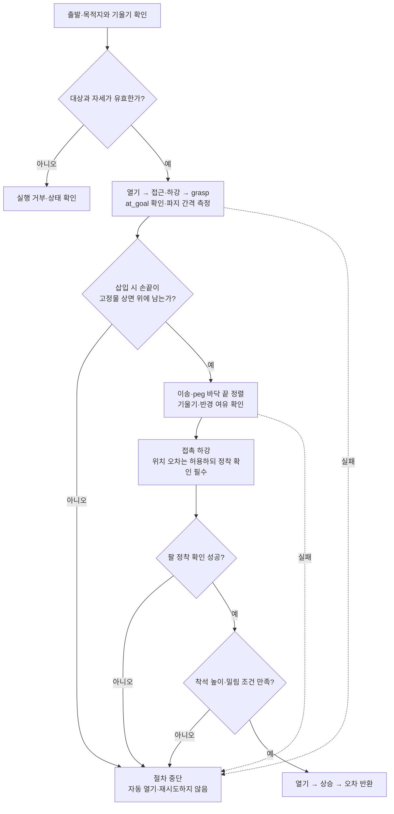
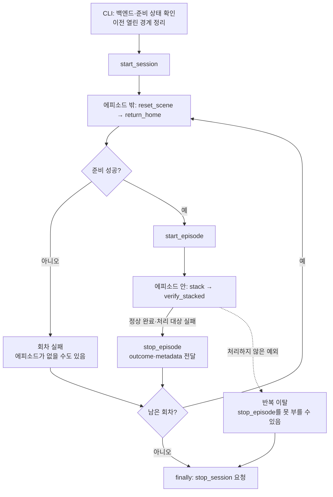

# RobotTwinClient 작업 및 데이터 수집 가이드

코드 확인 기준: 2026-10-23 · 대상: `robot-twin-client 0.1.0`

이 문서는 Layer 3의 작업 모듈과 Layer 4의 데이터 수집 모듈을 설명한다. 장면을 준비하고 집기·놓기·쌓기·peg 삽입을 실행하는 방법, 작업 성공과 실패를 판단하는 방법, 쌓기를 학습 데이터 에피소드로 수집하는 절차를 다룬다.

| 문서 | 역할 |
|---|---|
| [RobotTwinClient 가이드](RobotTwinClient_가이드.md) | Layer 1·2: 접속·HTTP API·예외·정착 판정·좌표 변환 |
| 이 문서 | 작업별 선행 조건·Python/CLI 실행·결과 판정·수집 경계 |
| [MCP 서버 설계 및 운영 가이드](로봇_트윈_MCP_서버_설계_및_운영_가이드.md) | 에이전트 연결·도구 노출·등록·호출 결과 계약 |

## 1. 작업 선택과 실행 조건

### 1.1 모듈별 역할

| 모듈 | 목적 | 대상 환경·선행 조건 | 세션·에피소드 생성 |
|---|---|---|---|
| `scene_reset` | 레시피 목록 조회와 물체 재배치 | `reset_scene`을 제공하는 mock·Isaac | 없음 |
| `pick_n_place` | 물체 집기·회전 이송·놓기 | 제공 Panda Hand 설정(mock·Isaac), 물체 배치 정보 | 없음 |
| `stack` | 물체를 받침 위에 쌓기·반복 평가 | Isaac, `scene_objects`와 물체 치수 | 없음 |
| `peg_in_hole` | peg을 다른 고정물로 옮겨 삽입 | 제공 펑션베이 씬, `fixtures`·`scene_objects`·`ee_pose` | 없음 |
| `collect` | 쌓기를 세션·에피소드 경계로 감싸 수집 | Isaac + 트윈 + 수집 계층 + 실제 기록 프로세스 | 있음 |

모든 모듈은 트윈을 HTTP로 호출하며 클라이언트 프로세스에 ROS를 요구하지 않는다. 이동·그리퍼 호출에는 기반 헬퍼를 사용하지만, 쌓기 결과나 peg 착석 등 **작업 성공 판정은 작업 모듈이 추가로 수행**한다.

`pick_n_place`와 `stack`은 TCP 목표를 만들고 `panda_hand.to_arm_command()`로 팔 명령에 맞춘다. `peg_in_hole`은 두 패드 사이 파지 중심인 `grasp_center` 목표를 그대로 보낸다. 이 기준점은 실제 손끝과 다르다. 기하 함수의 새 import 경로는 `geometry`, Panda Hand 보정은 `panda_hand`이며, `pick_n_place`의 재수출 이름은 호환용이다.

### 1.2 설치·접속·백엔드 확인

Python 3.10 이상과 `uv`를 사용한다. 프로젝트 루트에서 설치하며, 같은 가상환경으로 MCP도 사용한다면 두 번째 명령을 선택한다.

```bash
# 작업 CLI·라이브러리만 사용하는 환경
uv sync

# 같은 체크아웃에서 MCP도 사용하는 환경
uv sync --extra mcp
```

기본 `uv sync`는 선택되지 않은 MCP 의존성을 제거할 수 있다. MCP 병용 환경에서는 이후 동기화에도 `--extra mcp`를 붙인다.

제공 트윈의 접속값은 펑션베이 **`127.0.0.1:8801 / rdfp01`**, Isaac **`127.0.0.1:8801 / panda01`**, mock **`127.0.0.1:8801 / mock01`**이다(2026-10-25). 포트가 같아 동시에 띄우지 않으며, id로 환경을 판정하지 않으므로 한 환경씩 실행하고 `twin.meta()['backend']`로 확인한다. 서버·시뮬레이터 기동은 [로봇 트윈 사용자 가이드](../../../ros/rdfp_ws/docs/twin/로봇_트윈_사용자_가이드.md)를 따른다.

| 진입점 | 코드가 확인하는 것 |
|---|---|
| `robot-twin-pick` | MoveGroup 준비 + `panda_mock`·`panda_isaac` 확인. Panda Hand 보정을 쓰므로 펑션베이 트윈에서는 움직이기 전에 멈춘다 |
| `robot-twin-stack` | MoveGroup 준비 + 기본적으로 `panda_isaac` 확인. `--any-backend`는 확인을 생략하는 디버그 옵션 |
| `robot-twin-collect` | MoveGroup 준비 + `panda_isaac` 확인. 백엔드 확인을 끄는 옵션 없음 |
| `robot-twin-peg` | 메타데이터에 `fixtures` 변수가 있는지 확인 |
| `robot-twin-reset` | 카탈로그 조회 또는 `reset_scene` 호출. 팔 이동 명령은 보내지 않음 |

Python의 `stack()`·`collect()` 같은 함수를 직접 호출하면 CLI의 사전 검사가 자동으로 실행되지 않는다. 필요한 `require_backend()`·상태 확인은 호출자가 수행한다. 제공 펑션베이 설정에는 `reset_scene`이 없으며 Panda Hand 보정을 사용하는 작업을 그대로 적용하지 않는다. 펑션베이 트윈은 `grasp_center` 기준으로 프레임을 스스로 변환하므로, `pick()`·`place()`·`stack()`을 거기에 직접 쓰면 `to_arm_command()` 보정이 이중으로 걸려 목표가 **약 10 cm 아래**로 어긋나고 손목이 45° 돌아간다.

## 2. 장면 준비 — scene_reset

장면 레시피 이름은 연결된 트윈의 카탈로그로 확인한다. `robot-twin-reset`은 로봇 팔을 움직이지 않지만 물체 배치를 변경하며, 서버는 리셋 시 `scene`·`arm` 자원을 함께 점유할 수 있다.

Python에서는 `scene_reset.scene_names(twin)`으로 레시피 이름을 조회한다. `reset_scene` 연산 카탈로그의 `inputs_schema.properties.scene.enum`을 읽어 정렬된 목록을 반환하며, 연산이나 비어 있지 않은 enum 목록을 찾지 못하면 `None`을 반환한다. `None`은 사용할 장면이 없다는 확정 판정이 아니라 카탈로그에서 이름 목록을 얻지 못했다는 뜻이다. 이 함수는 장면을 변경하지 않으며 HTTP 예외는 호출자에게 전달한다.

```bash
uv run robot-twin-reset --list
uv run robot-twin-reset --scene initial
uv run robot-twin-reset --scene two_objects --seed 100
```

| 인자 | 기본값·동작 |
|---|---|
| `--scene` | `initial` |
| `--seed` | 생략하면 무작위 seed를 뽑아 출력 |
| `--list` | 레시피 이름만 조회하고 종료 |
| `--no-check` | `scene_objects` 갱신 대기·관측 출력 생략. 리셋 연산만 실행 |

기본 경로는 `stack.reset_scene()`을 이용해 배치하고, 요청된 배치와 관측 위치를 출력한다. `await_fresh_scene()`은 초기 표본 이후 수신 시각(없으면 원본 시각)이 바뀌는 것을 기본 2회, 최대 5초 기다린다.

**이 갱신 대기는 강제 성공 조건이 아니다.** 시각 정보가 없으면 즉시 통과하고, 시간 초과 시 경고와 `False`를 반환하지만 `reset_scene()`은 그 반환값으로 중단하지 않는다. 따라서 경고가 나왔다면 실제 `scene_objects`를 확인한 뒤 작업을 진행한다. 팔 정착을 판정하는 `ops.wait_until_still()`과는 다른 동작이다.

## 3. 집기와 놓기 — pick_n_place

### 3.1 기본 함수

| 함수 | 입력과 진행 | 반환 |
|---|---|---|
| `pick(twin, above, grasp, *, require_grasp=True)` | 열기 → 접근 → 하강 → grasp → 상승. `above`·`grasp`는 TCP pose | 단계 판정에 따라 bool |
| `place(twin, above, target)` | 접근 → 하강 → 열기 → 상승. 이미 물체를 쥔 상태에서 시작 | 단계 판정에 따라 bool |
| `return_home(twin, home='ready')` | named target으로 복귀 | 폐루프 여부를 포함한 기반 헬퍼의 `reached` |

직선 이동은 TCP 보정 후 `settle_sec=10`으로 정착을 확인한다. 위치 미도달·정착 실패는 다음 단계로 진행하지 않고 `False`로 반환한다. 통신·접수 거부·연산 예외가 모두 `False`로 바뀌는 것은 아니며 호출자에게 전파될 수 있다.

현재 `pick`·`place`의 열림 판정은 호환 필드 `reached_goal`, `pick`의 파지 판정은 `stalled`를 읽는다. 기반 `set_gripper()`는 `at_goal`이 있고 `reached_goal`이 없을 때 호환 필드를 채운다. 따라서 이 작업 모듈의 실제 판정 필드와 새 그리퍼 API의 `at_goal`을 구분해야 한다.

`require_grasp=False`와 CLI의 `--allow-empty-grasp`는 반환된 `stalled=False`를 허용한다. **그리퍼 연산 자체의 실패나 시간 초과를 무시하지는 않는다.** mock의 파지 연산이 서버에서 실패하면 이 옵션을 사용해도 시퀀스 완주는 보장되지 않는다. 실제 물체를 옮기는 작업에서는 파지 확인을 생략하지 않는다.

### 3.2 pick-and-place CLI

`reset_and_pick_and_place(twin, args)`는 `reset_scene` 출력의 첫 번째 물체를 선택한다. `geometry.grasp_pose_of()`로 파지 pose를 만들고, 베이스 z축 둘레로 `--angle`만큼 회전한 위치·자세에 놓는다. `-x/-y/-z`는 파지 위치를 축별 덮어쓰며, 높이 여유는 `--clearance`로 지정한다.

```bash
uv run robot-twin-pick --scene one_cube --seed 7 --angle 30
```

기본값은 `scene=one_cube`, `seed=0`, `angle=30°`, `clearance=0.10 m`, `home=ready`다. 양수 각도는 위에서 볼 때 반시계 방향이다. 이 명령은 리셋·팔 이동·그리퍼 동작을 수행하며 세션·에피소드는 만들지 않는다.

집기·놓기가 성공하면 복귀를 시도한다. 복귀가 `False`여도 이미 놓기를 마친 작업의 bool 결과를 뒤집지는 않는다. 다만 복귀 중 발생한 예외는 전파될 수 있다. `place()` 자체에는 복귀가 포함되지 않는다.

### 3.3 Python에서 조합하기

다음은 제공 Isaac 환경에서 장면의 물체 한 개를 골라 30° 회전 이송하는 예다. 실행하면 로봇을 움직인다. 장면·작업 경로는 실제 설정에 맞춰 준비한다.

```python
from robot_twin_client.client import RobotTwinClient, require_backend
from robot_twin_client.geometry import above_of, grasp_pose_of, rotated_about_base_z
from robot_twin_client.pick_n_place import pick, place, return_home


def main():
    twin = RobotTwinClient()
    require_backend(twin, 'panda_isaac', purpose='집기·놓기 예제')
    if twin.health().get('move_group') != 'READY':
        raise RuntimeError('MoveGroup 미준비')
    objects = twin.read('scene_objects')['objects']
    obj = objects['block_a']
    grasp = grasp_pose_of(obj)
    target = rotated_about_base_z(grasp, 30.0)
    if not pick(twin, above_of(grasp, clearance_m=0.15), grasp):
        raise RuntimeError('집기 중단 — 현재 위치와 파지 상태를 확인한다')
    if not place(twin, above_of(target, clearance_m=0.15), target):
        raise RuntimeError('놓기 중단 — 놓기 전후 어느 단계인지 확인한다')
    if not return_home(twin):
        print('놓기는 마쳤지만 ready 복귀를 확인하지 못했습니다.')


if __name__ == '__main__':
    main()
```

`pick`·`place`가 내부에서 좌표를 보정하므로 위 입력에 `to_arm_command()`를 추가 적용하지 않는다. 물체가 실제 목표에 놓였는지는 `scene_objects` 등으로 별도 확인한다.

## 4. 쌓기 — stack

### 4.1 진행과 결과 판정

`stack(twin, source_name, base_name, *, clearance_m=0.15, gap_m=0.004, require_grasp=True, home='ready')`는 장면을 리셋하지 않는다. 순서는 다음과 같다.

1. 두 물체의 위치·자세·치수를 읽고, 파지 위치와 쌓은 뒤의 높이 중 높은 쪽에 `clearance_m`을 더해 공통 이송 높이를 정한다.
2. `pick()`으로 집은 뒤 `held_offset()`으로 **손끝 − 물체 중심** 오프셋을 측정한다.
3. 받침 위치를 다시 읽고, 받침 상면 + 얹는 물체 반높이 + `gap_m` + 실측 오프셋으로 TCP 목표를 만든다. x·y도 오프셋으로 보정하며 파지 자세를 유지한다.
4. `place()` 후 `home`이 지정되어 있으면 복귀를 시도한다.

`stack()`의 `True`는 작업 시퀀스가 완료됐다는 뜻이다. 복귀의 `False`는 결과를 뒤집지 않으며, 물체가 실제 얹혔는지는 `verify_stacked()`로 확인한다.

| 함수 | 역할·결과 |
|---|---|
| `reset_and_stack(twin, source_name, base_name, *, scene='two_objects', seed=0, **kwargs)` | 리셋·대상 존재 확인 후 `stack()` 실행 |
| `held_offset(twin, name)` | 들어 올린 뒤 관측한 TCP 위치와 물체 중심의 차이 |
| `verify_stacked(twin, source_name, base_name, *, lateral_tol_m=0.02)` | 가로 거리 ≤ 20 mm, 중심 높이차와 두 반높이 합의 차이 ≤ 8 mm이면 `stacked=True` |
| `repeat_stack(..., times=N)` | 회차별 `index`, `seed`, `ok`, `check` 또는 `error` 목록 |

`verify_stacked()`는 `stacked`, `lateral_m`, `height_gap_m`, `expected_gap_m`을 반환한다. 장시간 안정성이나 접촉력을 검사하지는 않는다.

`stack.half_height_of(obj)`는 물체 한 개의 dict를 받아 다음 규칙으로 반높이(m)를 계산하는 순수 함수다. `type` 생략 시 `box`로 해석하고, 지원하지 않는 타입이면 `ValueError`를 발생시킨다. `dimensions`는 필수이며 물체 자세에 따른 기울기 보정은 하지 않는다.

| 물체 타입 | `dimensions` 순서 | 반높이 계산 |
|---|---|---|
| `box` | x, y, z | z / 2 |
| `cylinder`, `cone` | 높이, 반지름 | 높이 / 2 |
| `sphere` | 반지름 | 반지름 |

### 4.2 실행 방법

```bash
# 새 배치에서 한 번 쌓기 — seed를 명시한다
uv run robot-twin-stack --source block_a --base cylinder_a --seed 100

# 현재 배치를 유지하고 쌓기
uv run robot-twin-stack --source block_a --base cylinder_a --no-reset

# 매 회 배치를 바꾸며 평가 — 세션·에피소드는 만들지 않는다
uv run robot-twin-stack --repeat 10 --seed 100
```

`--repeat N`은 N ≥ 1이어야 하고, N > 1인 반복과 `--no-reset`은 함께 사용할 수 없다. 반복은 매 회 **ready 복귀 → 리셋 → 쌓기 → 작업 판정** 순서다. seed를 지정하면 n회차는 `seed + n - 1`이고, 생략하면 매 회 무작위다.

단일 리셋 실행도 같은 규칙을 따른다. `--seed`를 생략하면 무작위 정수를 뽑아 `seed=… (재현하려면 --seed …)`로 출력한다. `--no-reset`이면 seed를 사용하지 않는다.

Python에서는 다음처럼 시퀀스와 작업 판정을 구분한다. `twin`은 준비된 Isaac 클라이언트다.

```python
from robot_twin_client.stack import reset_and_stack, verify_stacked

completed = reset_and_stack(twin, 'block_a', 'cylinder_a', seed=100)
check = verify_stacked(twin, 'block_a', 'cylinder_a') if completed else None
ok = bool(completed and check and check['stacked'])
print({'sequence_completed': completed, 'ok': ok, 'check': check})
```

반복 중 처리하는 실패에서는 그리퍼 열기를 시도하고 다음 회로 넘어간다. 모든 예외를 처리하지는 않으며, 회차 전 복귀나 회차 후 `verify_stacked()`에서 발생한 예외는 반복을 종료할 수 있다. 이 복구 정책을 peg 작업에 적용하지 않는다.

## 5. Peg 삽입 — peg_in_hole

### 5.1 입력과 절차

제공 펑션베이 씬의 `peg`과 `fixtures`에 등록된 고정물을 대상으로 한다. 대표 고정물은 `peg_hole_round_16`, `peg_tray_round_16`이다. 실제 사용 가능한 이름은 연결된 트윈에서 읽는다.

| 함수 | 입력·반환 |
|---|---|
| `pick_peg(twin, *, verbose=True)` | 집은 뒤 peg 중심 z − `grasp_center` z인 파지 간격을 반환 |
| `place_peg(twin, destination, gap, *, travel_z=0.150, verbose=True)` | 앞에서 측정한 간격으로 삽입. `destination`, `seated=True`, 축별 `error_m` 반환 |
| `move_peg(twin, destination=None, *, go_home=True, verbose=True)` | 집기와 삽입을 연결하고 `source`도 반환. 목적지 생략 시 반대 고정물 선택 |

`move_peg()`는 목적지 존재·현재 위치와의 중복을 동작 전에 검사한다. `place_peg()`를 따로 호출할 때는 같은 파지에서 얻은 `gap`을 전달해야 한다. MCP 도구의 입력 이름은 `grasp_gap_m`이지만 Python 함수의 인자는 `gap`이다.



그림은 주요 판정의 요약이다. 이동과 관측 읽기에도 예외가 발생할 수 있으며, 절차 중단은 물리적 정지 명령을 뜻하지 않는다.

| 판정 | 현재 조건 |
|---|---|
| 기울기 | 15° 초과면 거부. 집기 전·후와 삽입 하강 전에 확인 |
| 기하 사전 확인 | 파지 간격·peg 수직 반높이·고정물 바닥으로 완전 삽입 목표 계산. 손끝이 고정물 상면 이하로 내려가야 하면 거부 |
| 정렬 | peg 바닥 끝을 최대 3회 보정. 반경 여유를 알면 정렬 오차가 그 여유의 40% 미만이어야 하강 |
| 착석 | peg 중심 z와 입구 z의 차이가 3 mm 미만이고, 초기 파지 간격 대비 밀림이 4 mm 이하 |

현재 주요 상수는 손끝 오프셋 0.044 m, 접근 높이 0.120 m, 이송 높이 0.150 m, 팔 정착 제한 15초다. 이 높이는 단순히 현재 위치에 더하는 상대 상승량이 아닌 베이스 기준 z 목표다. 상세 기하 값과 적용 조건은 [peg_in_hole.py](../src/robot_twin_client/peg_in_hole.py)를 따른다.

### 5.2 실행과 중단 처리

```bash
# 상태·목적지 표시만 수행하며 움직이지 않는다
uv run robot-twin-peg --dry-run

# 목적지를 생략하면 반대 고정물로 이동
uv run robot-twin-peg

# 목적지 지정, 시작·끝 ready 복귀 생략
uv run robot-twin-peg peg_tray_round_16 --no-home
```

`--dry-run`은 전체 경로·파지·삽입 가능성을 검증하는 시뮬레이션이 아니다. 상태와 목적지를 표시하는 단계까지만 수행한다. `--no-home`이 없으면 시작·끝에 named target 이동을 요청하지만, 현재 `move_peg()`는 그 호출의 `reached=False`를 중단 조건으로 사용하지 않는다. 따라서 완료 결과가 ready 복귀까지 보장하지는 않는다.

실패 시 `PegInHoleError`의 `holding=True`는 자동으로 그리퍼를 열지 않고 상태를 확인해야 한다는 표시다. 실제 파지를 다시 측정한 불리언은 아니며, 일부 관측·도달 실패에서도 보수적으로 설정된다. 일반 통신 예외나 `holding=False`만으로 빈손·안전 상태를 단정하지 않는다. 제공 펑션베이 씬에서 고정물 밖으로 물체를 잃으면 보통 시뮬레이터 재시작이 필요하다.

팔 정착과 peg 흔들림 대기는 다르다. 팔 이동은 `SETTLE_TIMEOUT`이면 접촉 하강에서도 중단한다. 반면 `wait_until_peg_still()`은 정렬 전 타이밍 보조이며 시간 초과 시 마지막 관측을 반환한다. 후속 정렬·착석 판정이 계속 필요하다. 품질이 낮은 상태 변수의 `_read()`는 최대 10초 동안 갱신을 기다린다.

## 6. 학습 데이터 수집 — collect

### 6.1 기록 준비와 경계

`collect()`는 **쌓기 작업**을 세션·에피소드로 감싼다. 다른 작업을 자동으로 수집하는 범용 래퍼는 아니다. `robot-twin-stack --repeat`은 경계를 생성하지 않으므로 `collect`와 구분한다.

Isaac 제어 스택·트윈 외에 다음 기록 프로세스를 준비한다.

| 구성 | 역할 |
|---|---|
| `rdfp_collect` launch | 세션 제어와 구성된 영상 기록 노드 |
| `./scripts/rosbag.sh record` | 녹화 목록(`config/recording_topics.list`)의 ROS 토픽 기록. `Ctrl+C`로 끝낸다 |
| `robot-twin-collect` | HTTP로 작업 실행과 세션·에피소드 경계 요청 |

Isaac에서는 `rdfp_ws`의 `./scripts/run_collect_isaac.sh`가 수집 계층과 rosbag 녹화를 함께 띄운다. `--with-stack`을 주면 제어 스택과 트윈까지 띄우고, 이미 떠 있는 트윈이 `panda_isaac`이 아니면 시작하지 않는다. 사용법은 그 스크립트의 머리 주석과 [Isaac 기동 runbook](../../../ros/rdfp_ws/docs/backends/isaac/isaac_bringup_runbook.md) §2를 따른다. 구성 요소를 따로 띄울 때는 ROS 환경을 준비한 별도 터미널에서 실행한다.

```bash
ros2 launch rdfp rdfp_collect.launch.py backend:=panda_isaac
./scripts/rosbag.sh record --rosbag-dir /data/rdfp/rosbag   # 또는 RDFP_ROSBAG_DIR
```

`rosbag.sh`는 녹화 명령을 `exec`로 넘긴다. 녹화 프로세스에 보낸 `SIGINT`가 `ros2 bag record`에 닿아야 `metadata.yaml`이 남고, 그래야 적재 대상이 된다.

rosbag 실행 옵션·저장 경로·토픽 선택은 [수집 계층 얹기 절차서](../../../ros/rdfp_ws/docs/collect/수집_계층_얹기_절차서.md)와 [rosbag 명령 가이드](../../../ros/rdfp_ws/docs/collect/rosbag_명령_가이드.md)를 따른다. MP4로 기록하는 카메라를 bag에 중복 포함하는 경우에는 적재 시 중복 스트림 문제가 생기지 않도록 해당 수집·적재 설정을 확인한다.

CLI의 `session_state` 확인은 영상·bag 파일이 실제 기록되는지까지 검사하지 않는다. 작업 완료 후에는 에피소드 목록과 실제 파일을 확인하고, 적재는 [데이터셋 적재 운영 가이드](../../../ros/rdfp_ws/docs/collect/데이터셋_적재_운영_가이드.md)를 따른다.



그림은 주요 경계만 보여 준다. 경계 요청 자체도 실패할 수 있다. 일반 반복 쌓기는 복귀 후 리셋하지만 수집 회차는 **리셋 후 복귀**하며, 두 동작 모두 에피소드 밖에 둔다. 에피소드 안의 `stack()`에도 종료 시 복귀가 포함될 수 있다.

### 6.2 함수와 실행

| 함수 | 책임 |
|---|---|
| `collect_episode(twin, source_name, base_name, *, scene='two_objects', seed=0, home='ready', **kwargs)` | 열린 세션 안에서 배치·복귀 후 에피소드 하나를 실행·종료 |
| `collect(twin, source_name, base_name, *, times, task_label='stack_block_on_cylinder', scene='two_objects', seed=None, **kwargs)` | 세션을 열고 회차를 반복한 뒤 `finally`에서 세션 종료 요청 |

CLI는 `collect()` 호출 전에 `_close_stale_session()`으로 이전 실행의 `IN_EPISODE`를 failure로 닫고, `IN_SESSION`을 닫는다. **`collect()` 직접 호출에는 이 사전 정리가 포함되지 않는다.** 다른 작업이 기록 중이라면 수집 CLI를 동시에 실행하지 않는다.

```bash
uv run robot-twin-collect --repeat 20 --seed 100 --summary-json out.json
```

기본 대상은 `block_a` → `cylinder_a`, 장면은 `two_objects`, `--task-label`은 `stack_block_on_cylinder`, 반복은 1회다. `--gap=0.004`, `--clearance=0.15`, `--home=ready`를 쌓기로 전달한다. seed를 지정하면 회차마다 1씩 증가하고 생략하면 매 회 무작위다.

### 6.3 결과와 종료의 한계

성공 회차는 `stack()`이 완료되고 `verify_stacked()['stacked']`도 참인 경우다. 에피소드 metadata에는 seed·scene·source·base·실제 배치(`placed`)·시퀀스 완료 여부와 가능한 판정·오류를 넣는다. 요약 JSON의 회차 결과에는 `index`, `seed`, `ok`와 가능한 `placed`, `check`, `error`가 들어간다.

| 상황 | 현재 처리 |
|---|---|
| 초기 ready 복귀가 `False` | 에피소드를 열지 않고 회차 실패 반환 |
| 쌓기 중 `KeyError`, `ValueError`, `TwinError`, `OperationFailed`, `TimeoutError` | 실패로 처리하고 `stop_episode` 요청 경로로 진행 |
| 결과 판정 중 `TwinError`, `OperationFailed`, `KeyError` | 판정 실패로 처리하고 `stop_episode` 요청 |
| `RuntimeError`(관측 품질 등), `URLError`, 사용자 중단 등 처리 목록 밖 예외 | `stop_episode`가 생략될 수 있음. 바깥 `collect()`의 `finally`는 세션 종료를 시도 |
| 경계 요청 실패 | 실패 회차로 처리되거나 호출자에게 전파. 실제 열린 경계 상태 확인 필요 |
| 마지막 `stop_session` | `run()`으로 요청하므로 서버의 실패 상태 반환을 자동 예외로 바꾸지 않음 |

`finally`는 종료 요청을 **시도**하는 것이며, 통신 장애·강제 종료까지 정리 성공을 보장하지 않는다. 다음 실행에서 상태를 확인해 남은 경계를 정리한다. 실패 회차 후 그리퍼 열기도 시도하지만 성공 여부를 보장하지 않는다.

**회차 수, 기록된 에피소드 수, 성공 수는 같지 않을 수 있다.** 리셋·복귀·경계 요청이 실패한 회차는 에피소드가 없다. 각 회차 결과의 `episode`가 경계를 열고 닫는 데까지 성공했는지를 나타내며, CLI는 마지막에 `N 회 중 에피소드 M 건 기록, 작업 성공 K 건`과 에피소드를 남기지 못한 회차의 seed를 출력한다.

| 결과 | 종료 코드 |
|---|---|
| 모든 회차가 에피소드를 남김 (작업 실패 회차 포함) | 0 — 작업 실패 에피소드도 정상적인 학습 데이터다 |
| 에피소드를 남기지 못한 회차가 있음 | 1 |

`episode=True`는 경계 요청이 성공했다는 뜻이며 영상·bag 파일이 실제로 기록됐다는 뜻은 아니다. `out.json`의 `ok`·`episode`와 실제 기록 파일을 함께 확인한다.

## 7. CLI 인자와 실패 확인

콘솔 스크립트는 총 6개이며, 이 문서는 MCP를 제외한 작업·수집 명령 5개를 다룬다. 모든 작업 명령의 접속 기본값은 `--url http://127.0.0.1:8801`이다. 트윈 ID 기본값은 `robot-twin-stack`·`robot-twin-collect`·`robot-twin-pick`·`robot-twin-reset`이 Isaac 트윈 `panda01`, `robot-twin-peg`가 펑션베이 트윈 `rdfp01`이다. peg만 옵션 이름이 `--twin`, 나머지는 `--twin-id`다.

| 명령 | 주요 추가 인자 | 정상 반환 경로의 종료 코드 |
|---|---|---|
| `robot-twin-reset` | `--scene`, `--seed`, `--list`, `--no-check` | 성공 0, 처리된 실패 1 |
| `robot-twin-pick` | `--scene`, `--seed`, `-x/-y/-z`, `--clearance`, `--angle`, `--home`, `--allow-empty-grasp` | 시퀀스 성공 0, 처리된 실패 1 |
| `robot-twin-stack` | `--source`, `--base`, `--scene`, `--seed`, `--repeat`, `--no-reset`, `--gap`, `--clearance`, `--home`, `--any-backend`, `--allow-empty-grasp` | 작업 판정 성공 0, 실패 1, 반복 인자 오류 2 |
| `robot-twin-peg` | 목적지 위치 인자, `--dry-run`, `--no-home` | 완료·dry-run 0, 처리된 실패 1 |
| `robot-twin-collect` | `--source`, `--base`, `--scene`, `--seed`, `--repeat`, `--gap`, `--clearance`, `--home`, `--task-label`, `--summary-json` | 모든 회차가 에피소드를 남김 0, 에피소드 누락·처리된 실패 1, 반복 인자 오류 2, 처리된 사용자 중단 130 |

파서의 잘못된 인자 입력은 일반적으로 코드 2로 종료한다. 처리되지 않은 예외는 traceback과 함께 종료될 수 있다. 각 명령의 옵션은 `uv run <명령> --help`로 확인한다. `python -m robot_twin_client`는 pick CLI로 연결되며, 명확한 진입점을 위해 콘솔 명령을 권장한다.

| 실패 증상 | 확인할 것 |
|---|---|
| `WrongBackend` | 주소 대신 메타데이터의 backend 확인 |
| `409 RESOURCE_BUSY` | 리셋·팔·그리퍼를 점유한 작업과 현재 자원 상태 |
| 접근·하강·상승 실패 | 좌표 기준·현재 위치·관측 갱신. bool 반환만으로 상세 원인이 모두 전달되지는 않음 |
| 쌓기 시퀀스는 끝났지만 `stacked=False` | 물체 중심·치수·가로 어긋남·실측 파지 오프셋 |
| peg의 `holding=True` | 자동 놓기·반복을 중단하고 실제 파지·고정물 상태 확인 |
| 수집 CLI 코드 1 · 에피소드 수 부족 | 출력의 "에피소드를 남기지 못한 회의 seed"와 요약의 `episode`·`error` |
| 수집 CLI 코드 0인데 데이터가 부족함 | 경계는 남았지만 기록이 빠진 경우다. 수집 계층·rosbag 기동 상태와 MP4·bag 파일 |

## 8. 검증과 참고 자료

### 8.1 테스트

작업·수집 관련 테스트는 다음과 같이 실행한다. 테스트는 가짜 트윈·시계를 사용하며 실제 로봇을 움직이지 않는다.

```bash
uv run --env-file .env pytest \
  tests/test_pick.py tests/test_reset_and_pick_and_place.py \
  tests/test_stack.py tests/test_peg_in_hole.py \
  tests/test_collect.py tests/test_scene_reset.py
```

`.env`는 ROS pytest 플러그인 자동 로드를 막는다. 기반·MCP까지 포함한 전체 검증은 `uv run --extra mcp --env-file .env pytest`로 실행한다. `test_collect.py`와 `test_scene_reset.py`는 현재 존재하며, 과거 문서의 “collect 테스트 없음”은 현행 상태가 아니다.

단위 테스트 통과는 실제 파지·착석·영상 기록을 검증한 결과가 아니다. 새 장면에서는 단일 회차의 작업 결과와 기록 파일을 확인한 뒤 반복 실행한다.

### 8.2 문서·코드

- [pick_n_place.py](../src/robot_twin_client/pick_n_place.py) · [stack.py](../src/robot_twin_client/stack.py) · [peg_in_hole.py](../src/robot_twin_client/peg_in_hole.py)
- [scene_reset.py](../src/robot_twin_client/scene_reset.py) · [collect.py](../src/robot_twin_client/collect.py) · [콘솔 스크립트 설정](../pyproject.toml)
- [RobotTwinClient 가이드](RobotTwinClient_가이드.md) · [MCP 서버 설계 및 운영 가이드](로봇_트윈_MCP_서버_설계_및_운영_가이드.md)
- [로봇 트윈 사용자 가이드](../../../ros/rdfp_ws/docs/twin/로봇_트윈_사용자_가이드.md) · [펑션베이 시뮬레이터 사용법](../../../ros/rdfp_ws/docs/backends/functionbay/펑션베이_시뮬레이터_사용법.md)

### 8.3 통합 출처와 보존 자료

기존 작업 모듈 문서와 분리 전 전체 가이드의 모듈 구성·접속·좌표 사용·정착 확인·검증 설명을 통합하고 현재 코드에 맞췄다. 관련 내용은 기반·작업 및 데이터 수집·MCP의 세 가이드로 재편했으며, 통합 전 Markdown 문서는 삭제했다. 이미지 자산은 유지한다. 작업 모듈 PDF는 저장소에서 삭제되었다.

- [과거 peg 판정 흐름 이미지](assets/robot-twin-client_작업_모듈/peg-in-hole_판정_흐름_원본.png)
- [과거 수집 경계 이미지](assets/robot-twin-client_작업_모듈/수집_경계_구조_원본.png)

이미지는 2026-10-15 기준 보존 자료다. 접속 정보·종료 보장·판정 흐름은 현재 본문을 따른다. 펑션베이의 과거 실증은 [peg-in-hole MCP 계획·기록](../../../ros/rdfp_ws/docs/backends/functionbay/peg_in_hole_via_mcp_plan.md)에 있으며, 이번 문서 통합에서 실제 로봇 시험을 다시 수행한 것은 아니다.
